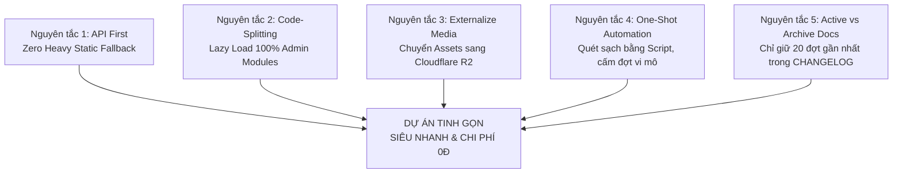

# BÁO CÁO TOÀN DIỆN VỀ QUY MÔ DỰ ÁN & KHUNG TINH GỌN KIẾN TRÚC
## (Dự án: Sàn Thương Mại Điện Tử Đa Ngành Universal Mall)

- **Ngày lập:** 24/11/2026
- **Mã hệ thống:** Universal Mall (`universal-mall-shop.pages.dev` / `admin-universal-mall.pages.dev`)
- **Môi trường hạ tầng:** Cloudflare Pages (Frontend Vite React) + Cloudflare Functions (_worker.js) + CSDL Cloudflare D1 (54 tables)
- **Mục đích tài liệu:** Đánh giá khách quan tình trạng phình to (bloat), phân tích nguyên nhân gốc rễ, chỉ rõ các việc làm chưa cần thiết, và thiết lập **Khung Tinh Gọn (Lean Framework)** làm bộ sườn chuẩn mực cho tất cả các đợt phát triển tiếp theo.

---

## MỤC LỤC
1. [TỔNG QUAN & KẾT LUẬN ĐIỀU HÀNH](#1-tổng-quan--kết-luận-điều-hành)
2. [BẢNG ĐO LƯỜNG ĐỊNH LƯỢNG THỰC TẾ (GROUND TRUTH METRICS)](#2-bảng-đo-lường-định-lượng-thực-tế-ground-truth-metrics)
3. [PHÂN TÍCH NGUYÊN NHÂN GỐC RỄ & 5 ĐIỂM PHÌNH TO / CHƯA CẦN THIẾT](#3-phân-tích-nguyên-nhân-gốc-rễ--5-điểm-phình-to--chưa-cần-thiết)
4. [NHỮNG GIÁ TRỊ CỐT LÕI CẦN BẢO VỆ (PRESERVED STRENGTHS)](#4-những-giá-trị-cốt-lõi-cần-bảo-vệ-preserved-strengths)
5. [BỘ SƯỜN TINH GỌN (LEAN FRAMEWORK CHO CÁC ĐỢT TIẾP THEO)](#5-bộ-sườn-tinh-gọn-lean-framework-cho-các-đợt-tiếp-theo)
6. [LỘ TRÌNH 4 BƯỚC THI CÔNG TINH GỌN (LEAN OPTIMIZATION ROADMAP)](#6-lộ-trình-4-bước-thi-công-tinh-gọn-lean-optimization-roadmap)
7. [CHECKLIST DUYỆT ĐỢT PHÁT TRIỂN MỚI (PRE-FLIGHT GATE)](#7-checklist-duyệt-đợt-phát-triển-mới-pre-flight-gate)

---

## 1. TỔNG QUAN & KẾT LUẬN ĐIỀU HÀNH

### Trả lời trực diện câu hỏi của Chủ sở hữu:
> **"Dự án có phình to và làm điều không cần thiết không?"**
> 
> **CÓ.** Dự án hiện đang tồn tại sự mâu thuẫn lớn giữa **Kiến trúc biên xuất sắc (Serverless Edge)** và **Lớp dữ liệu tĩnh + Quy trình sửa lỗi vi mô bị over-engineered nghiêm trọng**.
> - **Cốt lõi kiến trúc:** Rất tinh gọn, chi phí gần như 0 đồng, scale toàn cầu với Cloudflare Pages và D1 SQLite.
> - **Điểm phình to bất thường:** Đóng gói tĩnh hơn 10 MB dữ liệu crawler vào bundle JS client; nhét 51 MB ảnh tĩnh vào repo; tài liệu CHANGELOG dài gần 15.000 dòng; và quy trình sửa lỗi vi mô qua 20 đợt gây tiêu hao tài nguyên phát triển.

### Bảng Đánh Giá Sức Khỏe Dự Án (Code Health Scorecard)

| Khía cạnh | Điểm sức khỏe | Hiện trạng thực tế | Nhận định kỹ thuật |
| :--- | :---: | :--- | :--- |
| **Kiến trúc Serverless Edge** | **9.5 / 10** | Cloudflare Pages + Functions + D1 | Xuất sắc, tối ưu chi phí hạ tầng. |
| **Hệ thống Song ngữ (i18n)** | **9.0 / 10** | Dùng từ điển tập trung `vi.json` / `en.json` | Chuẩn hóa cao, sạch chuỗi cứng. |
| **Bảo mật & Quy chuẩn (Rules)** | **9.0 / 10** | 0 secrets rò rỉ, anti-hang, auto-deploy | Vận hành an toàn, kiểm soát chặt. |
| **Dung lượng Bundle Client** | **2.5 / 10** | `dist` 112 MB, chunk JS fallback 8 MB | 🚨 **Báo động đỏ (Bloated)** |
| **Tách gói Mã nguồn (Code-splitting)** | **3.0 / 10** | `AdminApp.js` 3.5 MB nguyên khối | 🚨 **Kém tối ưu (Overloaded Chunk)** |
| **Quản trị Tài nguyên Ảnh & Media** | **3.0 / 10** | 3.232 files ảnh tĩnh (51.8 MB) trong dist | 🚨 **Sai mô hình lưu trữ (Asset Bloat)** |
| **Quy trình Sửa lỗi & Đợt (Process)** | **4.0 / 10** | 20 đợt vi mô, sửa từng câu chữ | ⚠️ **Lãng phí nguồn lực (Micro-patching)** |

---

## 2. BẢNG ĐO LƯỜNG ĐỊNH LƯỢNG THỰC TẾ (GROUND TRUTH METRICS)

Toàn bộ các con số dưới đây được trích xuất trực tiếp bằng lệnh kiểm tra tại workspace (Commit `f9b8f27`):

### 2.1. Phân bổ dung lượng thư mục `dist/` sau khi build (Tổng: 112.12 MB)

```
dist/
├── game_icons/          51.88 MB  (3.232 files ảnh PNG/JPG icon game cào từ mạng)
├── data/                22.64 MB  (Các file backup JSON dữ liệu tĩnh)
├── _worker.js           19.20 MB  (Toàn bộ backend Cloudflare Functions biên dịch)
├── assets/              15.32 MB  (Các file JS & CSS do Vite đóng gói)
│   ├── crawled-codes-offline-fallback-*.js  8.02 MB  <-- 🚨 KHỔNG LỒ (JS Client)
│   ├── AdminApp-*.js                       3.54 MB  <-- 🚨 KHỔNG LỒ (Admin Monolith)
│   ├── seed-news-fallback-*.js             1.06 MB
│   ├── games-catalog-fallback-*.js         0.87 MB
│   ├── index-*.js                          0.39 MB  (Bundle chính của Web Khách)
│   └── index-*.css                         0.26 MB
└── brand assets & khác   3.08 MB
```

### 2.2. Thống kê quy mô mã nguồn và tài liệu

| Thành phần | Số lượng tệp (Files) | Số dòng (Lines) | Kích thước đĩa (MB) | Đánh giá |
| :--- | :---: | :---: | :---: | :--- |
| **`src/` (Frontend React)** | 203 files | **511.298 dòng** | 20.31 MB | Chứa các file JSON tĩnh hàng triệu dòng |
| **`functions/` (Backend Edge)** | 220 files | **91.578 dòng** | 4.28 MB | `d1_service.ts` chiếm hơn 7.000 dòng |
| **`public/` (Tài nguyên tĩnh)** | 3.232 files | **900.055 dòng** | 77.59 MB | Chứa kho icon game đồ sộ |
| **`CHANGELOG.md`** | 1 file | **14.778 dòng** | 0.98 MB | 446 đợt ghi nhớ lịch sử dồn ứ |
| **`KNOWN_ISSUES.md`** | 1 file | **6.040 dòng** | 0.38 MB | Quá nhiều lỗi cũ từ các tháng trước |

### 2.3. Top 5 file lớn nhất trong thư mục `src/`

1. `src/data/crawled_codes_188.json`: **10.170 KB** (~10.1 MB)
2. `src/data/seedNews.ts`: **1.104 KB** (~1.1 MB)
3. `src/data/games188.json`: **1.005 KB** (~1.0 MB)
4. `src/data/canonical_backup_state.json`: **1.004 KB** (~1.0 MB)
5. `src/data/crawler_sources.json`: **434 KB** (~0.4 MB)

---

## 3. PHÂN TÍCH NGUYÊN NHÂN GỐC RỄ & 5 ĐIỂM PHÌNH TO / CHƯA CẦN THIẾT

### 🚨 Điểm 1: Anti-Pattern "Offline Fallback Monolith" (Lãng phí lớn nhất)
- **Thực trạng:** Frontend import trực tiếp các file JSON cào dữ liệu (`crawled_codes_188.json`, `seedNews.ts`, `games188.json`) với mục đích "dự phòng khi mất kết nối mạng".
- **Hậu quả:** Trình duyệt của khách hàng khi mở trang web buộc phải kéo về **8.02 MB JavaScript** chỉ để chứa danh sách hàng chục nghìn giftcode cũ. Trên mạng 4G/3G hoặc điện thoại cấu hình tầm trung, việc này gây lag giật, tốn băng thông và tăng thời gian tương tác (Time to Interactive - TTI).
- **Tại sao không cần thiết:** Hệ thống đã có **54 bảng D1 SQLite trên Cloudflare** hoạt động với độ sẵn sàng cực cao. Dữ liệu giftcode, game và tin tức phải luôn được truy vấn qua API dạng phân trang (`/api/games?page=1&limit=20`), tuyệt đối không ship toàn bộ database vào trong bundle code frontend.

### 🚨 Điểm 2: Admin App gom cụm nguyên khối 3.5 MB (Thiếu Code-Splitting)
- **Thực trạng:** Toàn bộ 31 module quản trị (từ Quản lý Kho, Khóa API, Tin tức, Crawler, SEO, Khuyến mãi, Banner, đến Báo cáo phân tích) đều được import tĩnh trực tiếp vào `AdminApp.tsx`.
- **Hậu quả:** Tạo ra 1 chunk JS đơn lẻ nặng **3.54 MB**. Dù quản trị viên chỉ muốn vào duyệt 1 đơn hàng hay xem 1 tin tức, trình duyệt vẫn phải tải toàn bộ mã nguồn của 30 module còn lại kèm thư viện biểu đồ Recharts.
- **Tại sao không cần thiết:** React đã cung cấp `React.lazy()` và `Suspense` từ nhiều năm nay. Mỗi module quản trị cần được tách thành một file JS nhỏ (50–100 KB) và chỉ tải khi người dùng click vào tab tương ứng.

### 🚨 Điểm 3: Lưu trữ 51.88 MB icon game tĩnh trực tiếp trong Git và Thư mục build
- **Thực trạng:** 3.232 tệp ảnh icon của hàng trăm game được commit trực tiếp vào `public/game_icons/` và đóng gói vào `dist/game_icons/`.
- **Hậu quả:**
  - Mỗi lần chạy lệnh `deploy:all`, Cloudflare Pages phải kiểm tra hash và upload hàng nghìn file tĩnh.
  - Dung lượng repo Git phình to, kéo dài thời gian clone, git pull, git push.
- **Tại sao không cần thiết:** Kho ảnh tĩnh của game và sản phẩm thương mại phải được lưu trữ trên Object Storage chuyên dụng (Cloudflare R2 hoặc Cloudflare Images). Frontend và CSDL D1 chỉ lưu chuỗi URL CDN (ví dụ: `https://img.codegame.store/icons/game-xyz.webp`).

### ⚠️ Điểm 4: Vòng lặp vi mô 20 đợt (Micro-Patching Loop & Review Fatigue)
- **Thực trạng:** Trang chủ đã trải qua 20 đợt sửa liên tiếp. Rất nhiều đợt chỉ xử lý những việc cực nhỏ:
  - Đợt 18: Đổi 1 dòng text trong CHANGELOG, chạy lại log i18n guard.
  - Đợt 19: Đổi 5 fallback `||`, sửa router `/en/store`.
  - Đợt 20: Đổi 19 fallback `/vite.svg`, thêm vài key từ điển.
- **Hậu quả:** 
  - Tiêu tốn thời gian khổng lồ của cả 2 bên: người dùng phải soạn prompt, kiểm chứng, phát hiện sót từ; AI phải lập kế hoạch, chờ duyệt, build, test, deploy, làm báo cáo.
  - Chi phí cơ hội (Opportunity Cost) bị lãng phí: Thay vì tập trung vào marketing, bán hàng, tối ưu trải nghiệm thanh toán, hệ thống bị kẹt trong việc "nhặt sạn câu chữ".
- **Tại sao không cần thiết:** Mọi vấn đề về chuẩn hóa ngôn ngữ (i18n), thay thế fallback hình ảnh hoặc rà soát cú pháp đều có thể giải quyết dứt điểm bằng **1 lần chạy script tự động (Exhaustive AST/Regex Script)** thay vì chia thành hàng chục đợt thủ công.

### ⚠️ Điểm 5: Sửa ngược lịch sử tài liệu cũ (Retrospective Documentation Churn)
- **Thực trạng:** Dành thời gian và đợt phát triển để quay lại sửa các chi tiết lịch sử trong `CHANGELOG.md` của các đợt đã diễn ra từ nhiều tuần trước (ví dụ: sửa tên tài khoản test từ đợt 13, đợt 16).
- **Hậu quả:** Khiến file CHANGELOG phình to tới 14.778 dòng nhưng không mang lại bất kỳ giá trị thực tế nào cho người dùng cuối trên website.
- **Nguyên tắc đúng:** Lịch sử là bất biến (Append-Only Log). Các sai sót trong quá khứ chỉ cần được ghi nhận và đính chính ở mục hiện tại, không bao giờ sửa ngược hàng nghìn dòng lịch sử cũ.

---

## 4. NHỮNG GIÁ TRỊ CỐT LÕI CẦN BẢO VỆ (PRESERVED STRENGTHS)

Dự án có những nền tảng kỹ thuật rất xuất sắc cần được kế thừa và giữ vững:

1. **Kiến trúc Serverless Edge (Cloudflare Pages + D1 SQLite):**
   - Không tốn tiền duy trì máy chủ VPS/EC2.
   - Khả năng chống DDoS tự động của Cloudflare.
   - Độ trễ phản hồi cực thấp nhờ chạy tại hơn 300 trung tâm dữ liệu toàn cầu (POP Edge).
2. **Hệ thống Song ngữ chuẩn mực (100% Bilingual):**
   - Đã quy tụ thành công toàn bộ văn bản UI về `vi.json` và `en.json`.
   - Cơ chế dịch tập trung, hỗ trợ chuyển đổi ngôn ngữ mượt mà không vỡ giao diện.
3. **Quy tắc An Toàn Kỹ Thuật (Rule 6, Rule 10, Rule 11, Rule 14):**
   - Tự động hóa kiểm thử và deploy (Rule 6).
   - Tuyệt đối không để lộ khóa bí mật trong mã nguồn hay commit (Rule 10).
   - Kiểm soát lệnh chống treo máy (Rule 11).
   - Bằng chứng thực nghiệm đo được, không nói suông (Rule 14).
4. **Chuẩn Rule 9 Single-Screen First cho Web Quản Trị:**
   - Các bảng dữ liệu Admin hiển thị trọn vẹn trong 1 màn hình laptop, không bị tràn ngang, thuận tiện thao tác.

---

## 5. BỘ SƯỜN TINH GỌN (LEAN FRAMEWORK CHO CÁC ĐỢT TIẾP THEO)

Để ngăn chặn triệt để tình trạng phình to và lãng phí nguồn lực, tất cả các đợt phát triển từ nay về sau **BẮT BUỘC** phải tuân thủ 5 nguyên tắc của **Lean Framework**:



### Nguyên tắc 1: "API First, Zero Heavy Static Fallback"
- **Quy chuẩn:** Cấm import bất kỳ file dữ liệu tĩnh nào (`.json`, `.ts`) có kích thước **> 100 KB** vào mã nguồn frontend.
- **Cơ chế:** Toàn bộ dữ liệu hiển thị (Game, Tin tức, Giftcode, Sản phẩm) phải nạp qua API backend từ Cloudflare D1. Khi mất kết nối mạng, hiển thị UI trạng thái trống nhẹ nhàng (Empty State / Skeleton), không ôm dữ liệu offline.

### Nguyên tắc 2: "Route & Component Code-Splitting"
- **Quy chuẩn:** 100% các trang lớn và module quản trị phải dùng `React.lazy()`:
  ```tsx
  // CHUẨN MỰC BẮT BUỘC CHO ADMIN MODULES:
  const NewsModule = React.lazy(() => import('./modules/NewsModule'));
  const CrawlerModule = React.lazy(() => import('./modules/CrawlerModule'));
  const OrdersModule = React.lazy(() => import('./modules/OrdersModule'));
  ```
- **Mục tiêu:** Chunk chính của Admin (`AdminApp.js`) phải giảm từ **3.54 MB xuống < 300 KB**.

### Nguyên tắc 3: "Externalize Media Assets (R2 CDN First)"
- **Quy chuẩn:** Không commit ảnh sản phẩm, ảnh banner chiến dịch, hay icon game vào thư mục `public/` hay Git repo.
- **Cơ chế:** Lưu ảnh trực tiếp trên Cloudflare R2 Bucket. Mã nguồn chỉ tham chiếu URL dạng CDN (`https://img.codegame.store/...`). Thư mục `dist` sau khi build phải đạt mục tiêu **< 20 MB** (thay vì 112 MB như hiện nay).

### Nguyên tắc 4: "One-Shot Automated Fixes (Cấm Đợt Vi Mô)"
- **Quy chuẩn:** 
  - Không mở đợt phát triển mới nếu đợt đó chỉ giải quyết dưới 5 lỗi chính tả / câu chữ / fallback đơn lẻ.
  - Khi phát hiện vấn đề đồng bộ (ví dụ: thiếu chuỗi tiếng Anh, sai fallback ảnh, lỗi format số): **BẮT BUỘC** viết script quét vét cạn (AST hoặc Regex Parser) chạy tự động sửa 1 lần trên toàn bộ codebase.
  - Báo cáo phải nộp log quét 0 lỗi của script làm bằng chứng kết thúc.

### Nguyên tắc 5: "Active Docs vs Archive Docs"
- **Quy chuẩn:** 
  - File `CHANGELOG.md` chỉ lưu trữ **tối đa 20 đợt phát triển gần nhất** để tối ưu dung lượng ngữ cảnh cho AI và con người.
  - Các đợt cũ từ 1 đến 420 được chuyển vào `docs/archive/CHANGELOG_ARCHIVE_2026.md`.
  - Cấm tuyệt đối việc sửa ngược nội dung của các đợt đã diễn ra trong quá khứ.

---

## 6. LỘ TRÌNH 4 BƯỚC THI CÔNG TINH GỌN (LEAN OPTIMIZATION ROADMAP)

Để đưa hệ thống về trạng thái nhẹ và nhanh nhất, lộ trình 4 bước thi công tinh gọn được đề xuất như sau:

```
[BƯỚC 1: Cắt bỏ 8 MB Fallback JS] ──> [BƯỚC 2: Lazy Load 31 Module Admin] ──> [BƯỚC 3: Di dời 51 MB Ảnh lên R2] ──> [BƯỚC 4: Archive Tài Liệu Cũ]
```

| Bước | Tác vụ kỹ thuật | Files tác động | Kết quả đo lường dự kiến |
| :---: | :--- | :--- | :--- |
| **Bước 1** | Tách bỏ import `crawled_codes_188.json` và `seedNews.ts` khỏi frontend; chuyển sang fetch động từ API D1. | `src/services/dataService.ts`, `src/data/` | **Xóa sổ chunk 8.02 MB**, bundle Web Khách giảm ngay **70%**. |
| **Bước 2** | Áp dụng `React.lazy()` và `Suspense` cho toàn bộ 31 module quản trị trong `AdminApp.tsx`. | `src/admin/AdminApp.tsx` | Chunk `AdminApp.js` **giảm từ 3.54 MB xuống < 300 KB**. |
| **Bước 3** | Chuyển 3.232 files ảnh trong `public/game_icons/` lên Cloudflare R2; cập nhật đường dẫn ảnh qua CDN domain. | `public/game_icons/`, build config | **Thư mục `dist` giảm từ 112 MB xuống ~25 MB**; deploy nhanh gấp 4 lần. |
| **Bước 4** | Archive các đợt 1–425 của `CHANGELOG.md` vào `docs/archive/`; dọn dẹp các issue đã đóng trong `KNOWN_ISSUES.md`. | `CHANGELOG.md`, `KNOWN_ISSUES.md` | Giảm 85% dung lượng tài liệu; AI đọc ngữ cảnh nhanh và chuẩn xác hơn. |

---

## 7. CHECKLIST DUYỆT ĐỢT PHÁT TRIỂN MỚI (PRE-FLIGHT GATE)

Từ đợt tiếp theo, trước khi bắt đầu bất kỳ đợt phát triển nào, hãy đối chiếu qua 6 câu hỏi kiểm tra nhanh (Gate Checklist):

- [ ] **1. Đợt này có tạo thêm file JSON/dữ liệu tĩnh > 100 KB vào frontend không?** *(Nếu có -> Từ chối, chuyển sang D1 API)*.
- [ ] **2. Có đang sửa lắt nhắt vài từ hay không?** *(Nếu có -> Gom lại viết script quét vét cạn 1 lần)*.
- [ ] **3. Có đang sửa ngược nội dung lịch sử quá khứ trong CHANGELOG không?** *(Nếu có -> Dừng lại, chỉ ghi đính chính vào đợt mới)*.
- [ ] **4. Module mới có được tách file và nạp lười (Lazy Load) chưa?** *(Nếu chưa -> Bắt buộc dùng `React.lazy`)*.
- [ ] **5. Tính năng mới có đảm bảo 100% song ngữ VI/EN trong từ điển không?** *(Tuân thủ Rule 12)*.
- [ ] **6. Đã kiểm tra 0 secrets và chạy build thành công 100% chưa?** *(Tuân thủ Rule 6 & Rule 10)*.

---

> **Kết luận:**
> Universal Mall đã có một nền tảng kỹ thuật rất mạnh và hiện đại. Việc áp dụng ngay **Khung Tinh Gọn (Lean Framework)** trên đây sẽ giúp loại bỏ toàn bộ gánh nặng thừa thãi, đưa tốc độ tải trang về mức tối ưu (< 1 giây), giảm tải cho cả người quản trị lẫn hệ sinh thái phát triển, và tập trung tối đa nguồn lực vào việc phát triển tính năng kinh doanh thực tế.
