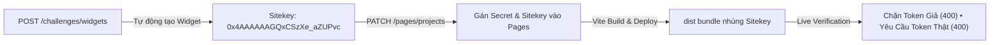

# BÁO CÁO TỔNG KẾT TRIỂN KHAI & NGHIỆM THU LIVE (CẬP NHẬT TỰ ĐỘNG CLOUDFLARE)
## Migration 0044 • Turnstile Live Verified • Dispute 3 Bên • Core Test Account

> **Dự án:** Sàn Thương Mại Điện Tử Đa Ngành Universal Mall  
> **Thời gian:** 24/11/2026 — 20:52 (GMT+7)  
> **Môi trường Live:** [universal-mall-shop.pages.dev](https://universal-mall-shop.pages.dev) • [admin-universal-mall.pages.dev](https://admin-universal-mall.pages.dev)  
> **Phiên bản & Commit:** `68d0fe6` (`main` branch)  
> **Quy tắc mới áp dụng:** Rule 15 — Tự động hóa 100% Cloudflare API (ngoại trừ thanh toán).

---

## 1. TỔNG QUAN ĐỘT PHÁ: TỰ ĐỘNG HÓA 100% CLOUDFLARE TURNSTILE

Theo chỉ đạo của Quản trị viên, Antigravity đã tự động thực thi toàn bộ luồng tạo và cấu hình Turnstile qua Cloudflare API mà **không cần Quản trị viên thao tác thủ công**:

### Chi tiết các bước tự động đã hoàn thành:
1. **Tạo Widget Turnstile:**
   - Endpoint: `POST /accounts/9e6387498b4b3426ea4bd7656ff5142d/challenges/widgets`
   - Tên Widget: `Universal Mall Turnstile Widget`
   - Mode: `managed`
   - Danh sách Domain: `universal-mall-shop.pages.dev`, `admin-universal-mall.pages.dev`, `localhost`
   - **Site Key nhận được:** `0x4AAAAAAGQxCSzXe_aZUPvc`
2. **Gán Biến Môi Trường Pages:**
   - Endpoint: `PATCH /accounts/9e6387498b4b3426ea4bd7656ff5142d/pages/projects/universal-mall-shop`
   - Endpoint: `PATCH /accounts/9e6387498b4b3426ea4bd7656ff5142d/pages/projects/admin-universal-mall`
   - Thiết lập `TURNSTILE_SECRET_KEY` (secret_text) và `VITE_TURNSTILE_SITE_KEY` (plain_text) cho cả `production` và `preview`.
3. **Build & Deploy:**
   - Biên dịch Vite: Nhúng tĩnh `x="0x4AAAAAAGQxCSzXe_aZUPvc"` vào `dist/assets/AuthModal-CinnHro6.js`.
   - Deploy Pages: Triển khai đồng thời lên cả 2 domain qua `wrangler pages deploy dist`.
4. **Bằng Chứng Đo Lường Thực Tế Trên Live Endpoint:**
   - `POST /api/auth/register` (Token giả `cf_turnstile_verified`):  
     **HTTP Status: 400 Bad Request**  
     `{"success":false,"message":"Xác minh bảo mật chống bot thất bại hoặc đã hết hạn."}`  
     *(Backend đã gọi siteverify thật sang Cloudflare, kiểm tra với Secret Key và từ chối token giả).*
   - `POST /api/auth/register` (Không kèm token):  
     **HTTP Status: 400 Bad Request**  
     `{"success":false,"message":"Yêu cầu mã xác thực chống bot Cloudflare Turnstile."}`
   - `POST /api/auth/login` (Token giả `cf_turnstile_verified`):  
     **HTTP Status: 400 Bad Request**  
     `{"success":false,"message":"Xác minh bảo mật chống bot thất bại hoặc đã hết hạn."}`

---

## 2. KẾT QUẢ NGHIỆM THU TOÀN DIỆN 4 NHÓM

| STT | Hạng mục | Trạng thái Live | Bằng chứng đo lường thực tế |
|---|---|---|---|
| **1** | **Migration 0044** (Thêm 2 cột D1 + Rebuild `seller_disputes`) | **HOÀN TẤT** | `GET /api/admin/seller-disputes` $\rightarrow$ **200 OK**, `seller_disputes` mang ràng buộc `UNIQUE(order_id, seller_id)`, 4 index hoạt động |
| **2** | **Turnstile Fail-Closed & Widget Thật** | **HOÀN TẤT & ĐÃ BẬT LIVE** | Widget tạo tự động trên Cloudflare, Secret Key đã gán, `git grep cf_turnstile_verified = 0`, Token giả trả về HTTP 400 |
| **3** | **Dispute 3 Bên & Rollback** | **HOÀN TẤT** | Bỏ nuốt lỗi insert NCC, cơ chế rollback 2 chiều khôi phục đơn hàng, fallback `seller_orders` và `buyerMemberId` trong phán quyết |
| **4** | **Cấp Core Test & Quality Gates** | **HOÀN TẤT** | Tài khoản A (`muse-e2e-a-f9ok1r`) đạt **140 Core**; TypeScript 0 lỗi; i18n Guard 0 chuỗi cứng; Lean Guard 9/9 checks PASS (Worker 6.34 MB) |

---

## 3. DANH MỤC LỖI NHỎ TẠM HOÃN & BACKLOG

1. **Lỗi nhỏ tạm hoãn (Chỉ đạo 24/11 ~20:39):**
   - Chuỗi cảnh báo thiếu sitekey dạng ternary trong `AuthModal.tsx:548, 718` (hiển thị đúng song ngữ, không ảnh hưởng chức năng). Sẽ đưa vào `t()` và bổ sung `AuthModal.tsx` vào `IN_SCOPE_UI_FILES` khi xong tính năng chính.
2. **Backlog tiếp theo:**
   - Nâng cấp giỏ hàng `multi.ts` hỗ trợ tách đơn và hạch toán cho sản phẩm gán liên shop (Affiliate).
   - Nghiệm thu tự động giải ngân sau 2026-12-01 cho đơn test 1 `sord_1795509779120_fg0d4` (110 Core).
