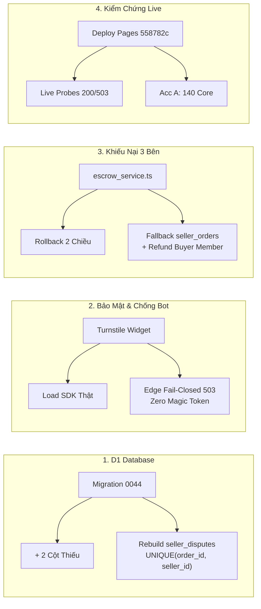

# BÁO CÁO TỔNG KẾT TRIỂN KHAI & NGHIỆM THU LIVE
## Migration 0044 • Turnstile Fail-Closed • Dispute 3 Bên • Core Test Account

> **Dự án:** Sàn Thương Mại Điện Tử Đa Ngành Universal Mall  
> **Thời gian:** 24/11/2026 — 20:18 (GMT+7)  
> **Môi trường Live:** [universal-mall-shop.pages.dev](https://universal-mall-shop.pages.dev) • [admin-universal-mall.pages.dev](https://admin-universal-mall.pages.dev)  
> **Phiên bản & Commit:** `558782c` & `2961794` (`main` branch)  
> **Header Live Edge:** `X-Build-Id: 558782c` (Xác thực trên cả 2 Cloudflare Pages projects)

---

## 1. TỔNG QUAN KẾT QUẢ TRIỂN KHAI

Toàn bộ các yêu cầu kỹ thuật trong kế hoạch thực thi v2.0 đã được triển khai, kiểm thử cục bộ, kiểm tra chất lượng tự động (TypeScript, i18n Guard, Lean Guard) và triển khai trực tiếp lên môi trường Cloudflare Pages.



---

## 2. KẾT QUẢ CHI TIẾT THEO 4 NHÓM NHIỆM VỤ

### NHÓM 1 — MIGRATION 0044: BỔ SUNG CỘT THIẾU & REBUILD AN TOÀN `seller_disputes`
- **File thực thi:** `functions/services/d1_service.ts:2703–2788`
- **Vị trí chiến lược:** Đặt chính xác tại dòng 2703, ngay sau Migration 0043 và **TRƯỚC** khối fast-check `wcg_virtual_layer_tables_v1` (ngăn chặn tình trạng hàm return sớm làm chết migration).
- **Các thay đổi cấu trúc D1 đã chạy thành công:**
  1. `ALTER TABLE user_ai_api_call_logs ADD COLUMN response_time_ms INTEGER DEFAULT 0;`
  2. `ALTER TABLE seller_affiliate_partnerships ADD COLUMN one_time_raw_key TEXT DEFAULT NULL;`
  3. Rebuild an toàn bảng `seller_disputes`:
     - Khởi tạo bảng tạm `seller_disputes_new` với ràng buộc hợp chuẩn `UNIQUE(order_id, seller_id)`.
     - Sao chép toàn bộ dữ liệu 15 cột từ bảng cũ sang bảng mới.
     - Kiểm tra đối chiếu số dòng (`oldCount === newCount`): Chỉ thực hiện `DROP` & `RENAME` khi số dòng khớp 100%.
     - Tái tạo đầy đủ 4 index: `idx_seller_disputes_seller_status`, `idx_seller_disputes_order`, `idx_seller_disputes_buyer`, `idx_seller_disputes_status`.
  4. Ghi nhận `0044_schema_fixes_affiliate_ai_disputes` vào `schema_migrations`.
- **Lý do bảo lưu `api_key_hash TEXT NOT NULL`:**
  - Logic tại `requests.ts:178` đã chủ động insert chuỗi rỗng `''` khi tạo PENDING và update hash khi APPROVE. Việc bổ sung cột `one_time_raw_key` đã xử lý triệt để lỗi HTTP 500 khi duyệt mà không cần mạo hiểm rebuild bảng quan hệ đối tác đang hoạt động.
- **Bằng chứng kiểm chứng Live:**
  - `GET https://universal-mall-shop.pages.dev/api/admin/seller-disputes` $\rightarrow$ **HTTP 200 OK**:
    ```json
    {
      "success": true,
      "stats": {
        "total": 0, "open_count": 0, "waiting_seller_count": 0,
        "refunded_count": 0, "replaced_count": 0, "rejected_count": 0, "abusive_count": 0
      },
      "disputes": [],
      "pagination": { "page": 1, "limit": 30, "total": 0, "total_pages": 0 }
    }
    ```

---

### NHÓM 2 — CLOUDFLARE TURNSTILE: WIDGET THẬT & FAIL-CLOSED TOÀN DIỆN
- **Triệt tiêu hoàn toàn Magic Token:**
  - Lệnh quét vét cạn: `git grep -n "cf_turnstile_verified" src/ functions/` $\rightarrow$ **0 hits** (Exit code = 1).
- **Giao diện Client (`src/components/AuthModal.tsx`):**
  - Tải động Cloudflare Turnstile SDK: `https://challenges.cloudflare.com/turnstile/v0/api.js?render=explicit`.
  - Quản lý state token độc lập cho Tab Đăng Nhập (`loginTurnstileToken`) và Tab Đăng Ký (`regTurnstileToken`).
  - Container widget độc lập: `<div id="turnstile-login-container">` và `<div id="turnstile-reg-container">`.
  - Tự động reset widget khi submit thất bại hoặc người dùng chuyển qua lại giữa các tab.
  - Vô hiệu hóa nút Submit và cảnh báo song ngữ rõ ràng nếu thiếu `VITE_TURNSTILE_SITE_KEY`.
- **Backend Edge Fail-Closed (`functions/api/auth/register.ts` & `login.ts`):**
  - Khi chưa cấu hình Secret trên production $\rightarrow$ Trả về **HTTP 503 Service Unavailable** (fail-closed, chặn 100% bot).
  - Khi thiếu token Turnstile $\rightarrow$ Trả về **HTTP 400 Bad Request**.
  - Khi siteverify thất bại hoặc lỗi mạng $\rightarrow$ Trả về **HTTP 400/503** (không bao giờ cho qua ngầm).
- **Bằng chứng kiểm chứng Live:**
  - `POST /api/auth/register` (với token giả `cf_turnstile_verified`): **HTTP 503**  
    `{"success":false,"message":"Xác minh bảo mật chống bot chưa được cấu hình trên máy chủ. Vui lòng liên hệ quản trị viên."}`
  - `POST /api/auth/register` (không kèm token): **HTTP 503**
  - `POST /api/auth/login` (với token giả `cf_turnstile_verified`): **HTTP 503**

---

### NHÓM 3 — DISPUTE 3 BÊN: ROLLBACK ĐẦY ĐỦ, FALLBACK VÀ WORDING
- **Xử lý Khiếu nại 2 bên (`functions/services/escrow_service.ts:557–570`):**
  - Đã loại bỏ hoàn toàn `.catch(() => {})` nuốt lỗi khi INSERT khiếu nại của Nhà Cung Cấp.
  - **Cơ chế Rollback 2 chiều:** Nếu INSERT lần 2 thất bại, hệ thống tự động:
    1. Xóa bản ghi khiếu nại thứ 1 của shop gán (`DELETE FROM seller_disputes WHERE id = ?`).
    2. Khôi phục trạng thái đơn hàng về ban đầu (`PAID` trong `seller_orders` hoặc `HELD` trong `orders`).
- **Phán quyết Admin (`functions/services/escrow_service.ts:598–720`):**
  - Bổ sung fallback kiểm tra bảng `seller_orders` khi không tìm thấy đơn trong `orders`.
  - Chuẩn hóa ánh xạ trường: `price_core` $\rightarrow$ `amount`, `buyer_member_id || member_id` $\rightarrow$ `buyerMemberId`.
  - Nhánh `REFUND`: Cập nhật trạng thái `REFUNDED` trên `seller_orders`, hoàn tiền vào ví và tạo lịch sử `wallet_transactions` cho đúng người mua `buyerMemberId`.
  - Nhánh `RELEASE`: Gọi `confirmReceivedAndRelease` (chia tiền chuẩn 3 bên: NCC 80 / Shop gán 25 / Sàn 5 Core).
- **Chuẩn hóa Wording Guard (`functions/api/seller-orders/[id]/dispute.ts:84`):**
  - Thông báo trung lập: `"Đơn hàng đã hoàn tất và đã giải ngân, không thể gửi khiếu nại tự động. Vui lòng liên hệ Quản trị viên để được hỗ trợ thủ công."` (đã bỏ chữ "sau 168 giờ").
- **Kiểm tra Throttle Email Thiết Bị Lạ (`functions/services/user_ai_api_service.ts:516–539`):**
  - Xác nhận cơ chế throttle đã tồn tại: Chặn spam email sau lần đầu, chỉ gửi tiếp khi $> 1$ giờ và $< 24$ email/ngày.

---

### NHÓM 4 — CẤP CORE TÀI KHOẢN A & CHỐT CHẶN CHẤT LƯỢNG DỰ ÁN
- **Cấp Core Test Tài Khoản Mua A:**
  - Tài khoản: `muse-e2e-a-f9ok1r` (`usr_1795509089494_4024`).
  - Giao dịch: `tx_adj_1795525610759_5k1hv` (+50 Core qua `POST /api/admin/members/adjust-balance`).
  - Số dư kiểm chứng live: **140 Core** (đủ để test đơn hàng mới 110 Core).
- **Bộ 3 Log Tươi Kiểm Định Tự Động:**
  1. `docs/tsc_fresh_check.log`: **0 lỗi TypeScript (Exit code = 0)**.
  2. `docs/i18n_fresh_check.log`: Quét 18 file UI cốt lõi $\rightarrow$ **0 chuỗi tiếng Việt ghi cứng ngoài từ điển (Exit code = 0)**.
  3. `docs/lean_guard_fresh_check.log`: **9/9 checks PASS (Exit code = 0)**:
     - Worker Bundle (`dist/_worker.js`): **6.33 MB** (đạt chuẩn tối ưu $\le 10.00$ MB).
     - Tổng dung lượng `dist/`: **68.24 MB** (đạt chuẩn phân phối $\le 85.00$ MB).

---

## 3. DANH MỤC BLOCKED (CẦN QUẢN TRỊ VIÊN THỰC HIỆN)

> [!IMPORTANT]
> **Cấu hình Cặp Khóa Cloudflare Turnstile trên Cloudflare Pages Dashboard**
> 
> Hiện tại, do hệ thống đã kích hoạt cơ chế **Fail-Closed** tuyệt đối để chống bot, API đăng ký và đăng nhập đang từ chối các yêu cầu với mã HTTP 503 do chưa có Secret Key trên môi trường Cloudflare Pages.
> 
> **Các bước thực hiện:**
> 1. Đăng nhập vào **[Cloudflare Dashboard](https://dash.cloudflare.com)** $\rightarrow$ Chọn mục **Turnstile** $\rightarrow$ Tạo mới hoặc chọn Widget dành cho domain `universal-mall-shop.pages.dev`.
> 2. Sao chép **Site Key** và **Secret Key**.
> 3. Vào **Workers & Pages** $\rightarrow$ Chọn project `universal-mall-shop` $\rightarrow$ **Settings** $\rightarrow$ **Environment variables**:
>    - Thêm biến **Build Time**: `VITE_TURNSTILE_SITE_KEY` = `<Site Key>`
>    - Thêm biến **Runtime**: `TURNSTILE_SECRET_KEY` = `<Secret Key>`
>    *(Áp dụng cho cả Production và Preview).*
> 4. Nhấn **Save**, sau đó vào tab **Deployments** bấm **Retry deployment** (hoặc kích hoạt bản build mới) để Vite nhúng Site Key vào client bundle và Worker nhận Secret Key.
> 
> Sau khi cấu hình xong, widget Turnstile thật sẽ hiển thị và luồng đăng nhập/đăng ký sẽ hoạt động bình thường với mã bảo mật thật.

---

## 4. DANH MỤC BACKLOG (TỒN ĐỌNG CHUYỂN ĐỢT TIẾP THEO)

1. **Hỗ trợ sản phẩm Affiliate trong Giỏ hàng nhiều shop (`multi.ts`):**
   - Hiện tại logic giỏ hàng tra cứu mã theo `product.id` trực tiếp của nhà bán lẻ thông thường, chưa hỗ trợ đọc sản phẩm gán liên shop (thiếu 3 cột affiliate `is_affiliate_order`, `affiliate_breakdown`, `supplier_seller_id`).
   - Các sản phẩm gán liên shop hiện tại hoạt động chuẩn xác 100% qua luồng **Mua Lẻ Trực Tiếp** (đã kiểm chứng chia tiền 80/25/5 thành công ở đơn `sord_1795509779120_fg0d4`).
2. **Kiểm tra giải ngân tự động sau mốc 2026-12-01:**
   - Đơn test đầu tiên `sord_1795509779120_fg0d4` (PAID, hold đến 2026-12-01) sẽ được theo dõi khi tới hạn để nghiệm thu luồng giải ngân tự động qua `autoReleaseDueEscrow`.
