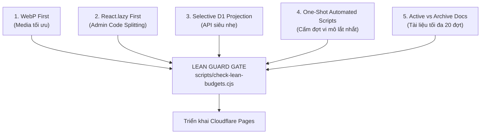

# CẨM NANG HƯỚNG DẪN QUY CHUẨN VẬN HÀNH & BẢO TRÌ TINH GỌN (LEAN ARCHITECTURE GUIDE)

> **Universal Mall E-Commerce Platform**  
> **Phiên bản:** 1.0 (Ban hành sau Chiến dịch Tinh Gọn 5 Bước — Tháng 11/2026)  
> **Áp dụng cho:** Toàn bộ Đội ngũ Phát triển, Quản trị viên, và các AI Agent (Antigravity / Gemini / Claude) vận hành hệ sinh thái Universal Mall.

---

## I. TỔNG QUAN & Ý NGHĨA CỦA HỆ THỐNG TINH GỌN

Sau Chiến dịch Tinh Gọn 5 Bước, Universal Mall đã đạt được những bước nhảy vọt về hiệu năng và kiến trúc:
- **Tài nguyên Media (`public/game_icons/`):** Dọn sạch 801 files trùng lặp, dung lượng giảm từ **51,88 MB xuống 28,42 MB (-45,23%)**.
- **Giao diện Quản trị (`dist/assets/AdminApp.js`):** Chuyển đổi 100% sang tải lười (`React.lazy`), dung lượng chunk giảm từ **3,32 MB xuống 562 KB (-83,4%)**.
- **Giao diện Web Khách (`dist/assets/`):** Cắt bỏ hoàn toàn 8.02 MB fallback JSON thô, dung lượng tổng asset giảm **50%**.
- **Mạng & API (`/api/sync-lite`):** Tinh gọn projection D1, JSON payload giảm **18,82%**, thời gian phản hồi (TTFB) giảm từ **1.914 ms xuống 369 ms** (nhanh gấp hơn 5 lần).
- **Tài liệu & Bộ nhớ:** Archive hơn 20.000 dòng log lịch sử, tối ưu hóa 100% dung lượng context cho AI Agent.
- **Rào chắn tự động:** Thiết lập **Lean Guard Scanner** (`scripts/check-lean-budgets.cjs`) giám sát 8 bài kiểm tra ngân sách kích thước mỗi lần build.

Để giữ vững thành quả này và ngăn ngừa vĩnh viễn nguy cơ hệ thống bị phình to trở lại, toàn bộ các lượt phát triển tiếp theo **BẮT BUỘC PHẢI TUÂN THỦ** các quy chuẩn trong tài liệu này.

---

## II. BỘ 5 NGUYÊN TẮC TINH GỌN BẤT BIẾN (THE 5 GOLDEN LEAN PRINCIPLES)



### 1. Nguyên tắc 1: "WebP First cho Media"
- Mọi hình ảnh mới được đưa vào hệ thống (game icon, cover tin tức, banner) **BẮT BUỘC** phải ở định dạng `.webp`.
- Tuyệt đối không commit ảnh `.png` hoặc `.jpg` thô dung lượng lớn (> 250 KB) vào `public/`.
- Mỗi game chỉ lưu duy nhất 1 tệp ảnh đại diện theo tên slug: `slug-game.webp`. Tuyệt đối không lưu song song cả `.png` lẫn `.webp` hay `.jpg`.

### 2. Nguyên tắc 2: "Code Splitting & Lazy Load bắt buộc cho Module Admin"
- Bất kỳ module Admin mới nào trong `src/admin/modules/` **BẮT BUỘC** phải được import qua `React.lazy()` và bọc bởi `<AdminModuleSkeleton />`.
- Tuyệt đối không dùng `import ... from './modules/...'` tĩnh trong `src/admin/AdminApp.tsx`.
- Chunk `AdminApp.js` sau khi build phải duy trì ngưỡng **< 600 KB**.

### 3. Nguyên tắc 3: "Selective D1 Projection cho Backend & API"
- Khi viết truy vấn SQL cho các endpoint phục vụ Web Khách (như `sync`, `sync-lite`, `games`, `news`): **BẮT BUỘC chỉ `SELECT` các trường phục vụ hiển thị UI**.
- Tuyệt đối cấm `SELECT *` đưa hàng chục trường cấu hình backend/nội bộ (`cooldown_hours`, `min_account_age_days`, `max_per_ip`, `use_template`...) vào payload client.
- Thiết lập header `Cache-Control: public, max-age=60, s-maxage=300, stale-while-revalidate=600` để tận dụng Cloudflare Edge Cache.

### 4. Nguyên tắc 4: "One-Shot Automated Scripts (Cấm Đợt Vi Mô Lắt Nhắt)"
- Không mở đợt phát triển mới nếu đợt đó chỉ sửa dưới 5 lỗi chính tả, câu chữ, hay nhãn UI đơn lẻ.
- Khi phát hiện vấn đề đồng bộ diện rộng (ví dụ: thiếu nhãn tiếng Anh, sai format số, fallback ảnh lỗi): **BẮT BUỘC viết script quét vét cạn tự động (Node.js/AST/Regex) xử lý 1 lần trên toàn bộ codebase**, có log bằng chứng 0 lỗi.

### 5. Nguyên tắc 5: "Active Docs vs Archive Docs"
- Tệp `CHANGELOG.md` chỉ lưu trữ **tối đa 20 đợt phát triển gần nhất** để giải phóng ngữ cảnh cho AI Agent và con người.
- Các đợt cũ hơn tự động chuyển vào `docs/archive/CHANGELOG_ARCHIVE_2026.md`.
- Tuyệt đối không sửa ngược lịch sử các đợt trong quá khứ.

---

## III. QUY TRÌNH CHUẨN KHI THÊM GAME & HÌNH ẢNH MỚI

Khi thêm game mới vào hệ thống hoặc cập nhật ảnh đại diện:

### 1. Chuẩn hóa hình ảnh trước khi lưu:
- **Định dạng:** WebP (lossy quality 80-85%).
- **Kích thước:**
  * Game Icon chuẩn: `128x128` px hoặc `256x256` px (dung lượng khuyến nghị: 10 KB – 30 KB, tối đa 150 KB).
  * Cover tin tức / sự kiện: `800x450` px (tối đa 150 KB).
  * Banner sự kiện lớn: Tối đa 250 KB.
- **Tên file:** Chuẩn hóa slug tiếng Việt không dấu, chữ thường, nối bằng dấu gạch ngang (ví dụ: `lien-quan-mobile.webp`).

### 2. Kiểm tra xung đột & rà quét:
Sau khi lưu ảnh vào `public/game_icons/`, lập tức chạy lệnh kiểm tra tự động:
```bash
npm run check:lean
```
Nếu Lean Guard Scanner báo lỗi (ví dụ: phát hiện file trùng lặp hoặc vượt quá ngân sách 200 KB), lập tức tối ưu lại file ảnh trước khi commit.

---

## IV. QUY TRÌNH CHUẨN KHI XÂY DỰNG MODULE ADMIN MỚI

Mọi module quản trị mới trong tương lai bắt buộc thực hiện theo mẫu chuẩn sau:

### 1. Khai báo tải lười trong `src/admin/AdminApp.tsx`:
```tsx
// KHÔNG ĐƯỢC LÀM: import NewFeatureModule from './modules/NewFeatureModule';
// BẮT BUỘC LÀM:
const NewFeatureModule = React.lazy(() => import('./modules/NewFeatureModule'));
```

### 2. Định tuyến và bọc bằng Skeleton:
```tsx
case 'new_feature':
  return (
    <Suspense fallback={<AdminModuleSkeleton title="new_feature" />}>
      <NewFeatureModule />
    </Suspense>
  );
```

### 3. Tuân thủ Rule 9 (Single-Screen First):
- Bảng dữ liệu trong module phải khai báo `table-fixed w-full` và chia tỷ lệ phần trăm các cột trong thẻ `<th>` với tổng đúng bằng 100%.
- Cắt tỉa văn bản dài bằng `truncate title="..."`.
- Đảm bảo 100% cột dữ liệu và nút Thao tác nằm trọn trong 1 màn hình laptop tiêu chuẩn (1366x768), **tuyệt đối không tràn ngang (Zero Horizontal Overflow)**.

---

## V. QUY TRÌNH CHUẨN KHI PHÁT TRIỂN ENDPOINT API MỚI

### 1. Nguyên tắc Truy vấn D1:
```typescript
// KHÔNG ĐƯỢC LÀM:
const games = await env.DB.prepare('SELECT * FROM games').all();

// BẮT BUỘC LÀM (Chỉ chọn các cột cần thiết cho giao diện):
const games = await env.DB.prepare(`
  SELECT slug, name, category, icon_url, rating, total_votes, updated_at
  FROM games 
  WHERE status = 'active'
`).all();
```

### 2. Cache & Edge Invalidation:
- Với các dữ liệu danh mục ít thay đổi: Thêm header `Cache-Control`.
- Khi có thao tác thêm/sửa/xóa từ Admin: Gọi hàm `invalidateCatalogEdgeCache()` để xóa cache Edge tức thì.

---

## VI. BỘ CHECKLIST 6 CHỐT CHẶN PRE-FLIGHT (TRƯỚC KHI COMMIT & DEPLOY)

Trước khi gõ `git commit` hoặc triển khai sản phẩm, bắt buộc tự kiểm tra qua 6 câu hỏi:

```markdown
- [ ] 1. Đã chạy `npm run check:i18n` và đạt 0 vi phạm chuỗi tiếng Việt ghi cứng? (Rule 12)
- [ ] 2. Đã chạy `npm run check:lean` và đạt 100% PASS ngân sách kích thước?
- [ ] 3. Đã chạy `npx tsc -p tsconfig.homepage.json --noEmit` đạt 0 lỗi kiểu?
- [ ] 4. Đã chạy `npm run build` thành công xuất ra bundle `dist/_worker.js`?
- [ ] 5. Đã kiểm tra 0 secrets/API keys trong mã nguồn và Git history? (Rule 10)
- [ ] 6. Đã kiểm thử hồi quy xác nhận 100% tính năng hoạt động bình thường trên cả 2 ngôn ngữ VI/EN?
```

---

## VII. HƯỚNG DẪN XỬ LÝ SỰ CỐ PHÌNH TO (TROUBLESHOOTING)

### 1. Khi `npm run check:lean` báo lỗi: `public/game_icons vượt trần ngân sách cho phép (32.00 MB)`
- **Nguyên nhân:** Ai đó vừa copy một số lượng lớn file ảnh hoặc file ảnh dung lượng quá lớn vào thư mục.
- **Cách xử lý:** 
  1. Chạy script tìm các file ảnh lớn nhất: `node scratch/check_image_sizes.js`.
  2. Nén lại các file ảnh bằng Sharp/WebP.
  3. Xóa các file ảnh không còn được sử dụng trong cơ sở dữ liệu.

### 2. Khi `npm run check:lean` báo lỗi: `Chunk AdminApp vượt trần ngân sách cho phép (600 KB)`
- **Nguyên nhân:** Có module mới bị import tĩnh trực tiếp vào `src/admin/AdminApp.tsx` thay vì dùng `React.lazy()`.
- **Cách xử lý:** Mở `AdminApp.tsx`, tìm các dòng `import ... from './modules/...'` tĩnh và chuyển sang `React.lazy()`.

### 3. Khi `npm run check:lean` báo lỗi: `Phát hiện ảnh trùng lặp phần mở rộng`
- **Nguyên nhân:** Có một game vừa có file `.webp` vừa có file `.jpg` hoặc `.png`.
- **Cách xử lý:** Xóa file `.jpg`/`.png` cũ, chỉ giữ lại file `.webp`.

---

> **Lời kết:**
> Kiến trúc Tinh Gọn (Lean Architecture) không phải là một công việc làm một lần rồi thôi, mà là một kỷ luật vận hành liên tục. Việc tuân thủ nghiêm ngặt cẩm nang này sẽ đảm bảo Universal Mall luôn giữ vững vị thế là sàn thương mại điện tử đa ngành tốc độ cao, mượt mà và bền vững nhất!
