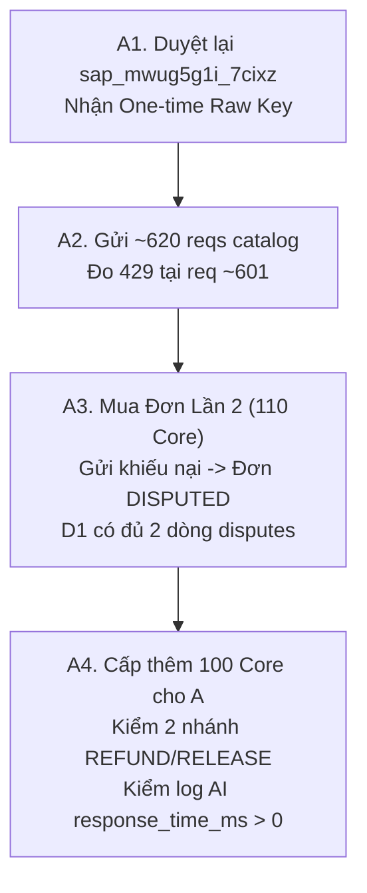
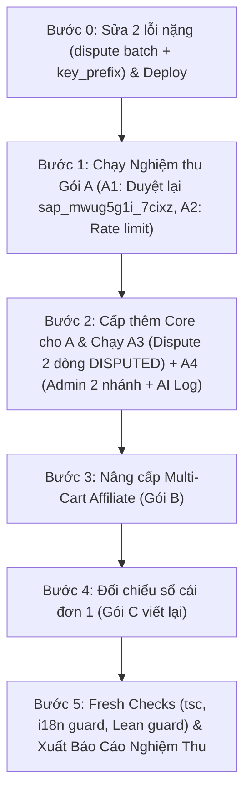

# KẾ HOẠCH TRIỂN KHAI GIAI ĐOẠN TIẾP THEO (v3.0)
## Tiếp Thu Trọn Vẹn 2 Sửa Nghiêm Trọng + 4 Sửa Nhỏ Đã Được Duyệt

> **Dự án:** Universal Mall Platform (`universal-mall-shop.pages.dev`)  
> **Trạng thái:** Chờ Quản trị viên duyệt (Pending User Final Approval)  
> **Phiên bản:** 3.0 (Cập nhật chuẩn hóa sau khi tiếp thu trọn vẹn 6 điểm sửa từ Quản trị viên lúc 21:00, 24/11/2026)  
> **Cam kết:** Bám sát hiện trạng mã nguồn commit `039640e`, đo lường thực tế trên D1 live, không đoán mò, tuân thủ Rule 10, Rule 11, Rule 12, Rule 14 và Rule 15.

---

## 0. DANH MỤC LỖI NHỎ TẠM HOÃN (DEFERRED BACKLOG)

Theo chỉ đạo của Quản trị viên (24/11 ~20:39), lỗi nhỏ không ảnh hưởng đến an ninh bảo mật và vận hành hệ thống được tạm thời lưu lại, không đưa vào lệnh sửa chính, nhắc lại sau khi các tính năng cốt lõi hoàn thành:

| STT | Vấn đề ghi nhận | Vị trí mã nguồn | Hiện trạng | Kế hoạch xử lý khi nhắc lại |
|---|---|---|---|---|
| 1 | Chuỗi cảnh báo Turnstile ghi cứng bằng ternary | `src/components/AuthModal.tsx:548, 718` | Hiển thị đúng 2 ngôn ngữ qua ternary VI/EN, không ảnh hưởng chức năng | Chuyển chuỗi sang gọi hàm `t()`, bổ sung khóa song ngữ vào `vi.json` và `en.json`, thêm `src/components/AuthModal.tsx` vào `IN_SCOPE_UI_FILES` của script i18n guard |

---

## BƯỚC 0 — SỬA 2 LỖI NẶNG & DEPLOY TRƯỚC KHI CHẠY GÓI A (BẮT BUỘC)

> [!CAUTION]
> **Điểm cốt tử:** Nếu không sửa 2 lỗi này trước thì Gói A sẽ thất bại ngay lập tức:
> - Catalog đối tác khóa cặp sẽ trả **HTTP 500 mọi lần** (do sai tên cột `api_key_prefix` trong query COUNT của `seller_affiliate_service.ts:143`).
> - Route khiếu nại `seller-orders/[id]/dispute.ts` chỉ có 1 lệnh INSERT trong `db.batch`, dẫn đến **chỉ có 1 dòng dispute** (NCC không bao giờ có dòng theo dõi).
> 
> Vì vậy, **Bước 0 BẮT BUỘC phải thực hiện và deploy live trước khi bước vào nghiệm thu Gói A.**

### 0.1. Sửa Lỗi 1: Thêm INSERT dòng 2 cho NCC vào `db.batch` của route khiếu nại
- **File:** `functions/api/seller-orders/[id]/dispute.ts:152–177`
- **Hiện trạng:** `db.batch` chỉ có 1 câu lệnh INSERT vào `seller_disputes` cho `order.seller_id` (shop gán).
- **Cách sửa chuẩn:**
  1. Kiểm tra nếu đơn hàng là affiliate: `order.is_affiliate_order === 1 && order.supplier_seller_id`.
  2. Khởi tạo `supplierDisputeId = 'sdisp_' + Date.now() + '_' + Math.random().toString(36).substring(2, 7)`.
  3. Bổ sung câu lệnh INSERT thứ 2 vào mảng `batchStatements` dành riêng cho Nhà Cung Cấp (`order.supplier_seller_id`):
     ```ts
     const batchStatements = [
       // Dòng 1: Khiếu nại cho Shop gán (Reseller)
       env.DB.prepare(`
         INSERT INTO seller_disputes (
           id, order_id, buyer_member_id, seller_id, reason, detail,
           status, is_flagged_abusive, created_at, updated_at
         ) VALUES (?, ?, ?, ?, ?, ?, 'OPEN', ?, ?, ?)
       `).bind(disputeId, orderId, buyerId, order.seller_id, reason, detail || null, isFlaggedAbusive, nowIso, nowIso),

       // Cập nhật trạng thái đơn sang DISPUTED
       env.DB.prepare(`
         UPDATE seller_orders
         SET status = 'DISPUTED', report_reason = ?, reported_at = ?, updated_at = ?
         WHERE id = ?
       `).bind(reason, nowIso, nowIso, orderId)
     ];

     // Dòng 2: Khiếu nại cho Nhà Cung Cấp (nếu là đơn affiliate)
     if (order.is_affiliate_order === 1 && order.supplier_seller_id) {
       const supplierDisputeId = `sdisp_${Date.now()}_sup_${Math.random().toString(36).substring(2, 7)}`;
       batchStatements.push(
         env.DB.prepare(`
           INSERT INTO seller_disputes (
             id, order_id, buyer_member_id, seller_id, reason, detail,
             status, is_flagged_abusive, created_at, updated_at
           ) VALUES (?, ?, ?, ?, ?, ?, 'OPEN', ?, ?, ?)
         `).bind(supplierDisputeId, orderId, buyerId, order.supplier_seller_id, reason, detail || null, isFlaggedAbusive, nowIso, nowIso)
       );
     }

     await env.DB.batch(batchStatements);
     ```

### 0.2. Sửa Lỗi 2: Đổi `api_key_prefix` $\rightarrow$ `key_prefix` trong kiểm tra Rate Limit
- **File:** `functions/services/seller_affiliate_service.ts:143`
- **Hiện trạng:**
  ```ts
  SELECT COUNT(*) as recent_calls 
  FROM seller_affiliate_call_logs 
  WHERE api_key_prefix = ? AND created_at >= datetime('now', '-1 minute')
  ```
  *(Schema D1 của bảng `seller_affiliate_call_logs` là `key_prefix`, không có cột `api_key_prefix` $\rightarrow$ SQLite crash HTTP 500).*
- **Cách sửa chuẩn:**
  ```ts
  SELECT COUNT(*) as recent_calls 
  FROM seller_affiliate_call_logs 
  WHERE key_prefix = ? AND created_at >= datetime('now', '-1 minute')
  ```

### 0.3. Build & Triển Khai Bước 0 Lên Cloudflare Pages
- Chạy `cmd /c npm run build`.
- Chạy deploy `wrangler pages deploy dist` cho cả 2 dự án: `universal-mall-shop` và `admin-universal-mall`.
- Đo lường xác nhận header `X-Build-Id` mới trước khi bắt đầu Gói A.

---

## GÓI A — NGHIỆM THU LIVE E2E (LIVE ACCEPTANCE TESTING)



### A1. Duyệt Lại Partnership Cũ & Độc Quyền Nhận One-Time Raw Key
- **Bối cảnh:** Shop C và NCC B đã có partnership `sap_mwug5g1i_7cixz` (APPROVED). Nếu gửi yêu cầu mới sẽ bị chặn 400.
- **Kịch bản nghiệm thu:**
  1. NCC B (`sel_1795509244037_dtr8h`) gọi duyệt lại chính partnership cũ:
     - Endpoint: `POST /api/seller/affiliate/requests/sap_mwug5g1i_7cixz/approve`.
     - **Kỳ vọng:** Trả về **HTTP 200 OK** (hết lỗi 500 do thiếu cột `one_time_raw_key`).
     - Phản hồi **CHỈ CHỨA** `key_prefix` (dạng `wcg_shop_xxxx••••xxxx`), tuyệt đối **KHÔNG** trả về `raw_key`.
  2. Shop C gọi `GET /api/seller/affiliate/requests` (Lần 1):
     - **Kỳ vọng:** Trả về `one_time_raw_key` đầy đủ.
  3. Shop C gọi `GET /api/seller/affiliate/requests` (Lần 2):
     - **Kỳ vọng:** `one_time_raw_key` trả về `null` (D1 đã cập nhật thành NULL).

### A2. Đo Lường Chính Xác Giới Hạn Tốc Độ (Rate Limit 600 req/min)
- **Kịch bản nghiệm thu:**
  1. Dùng `raw_key` nhận được từ Bước A1, gửi burst ~620 requests vào `GET /api/seller/affiliate/catalog`.
  2. **Tiêu chí nghiệm thu (đã chuẩn hóa):**
     - Ghi nhận số thứ tự request đầu tiên trả về **HTTP 429 Too Many Requests** (kỳ vọng quanh request 601).
     - Phản hồi JSON: `{"success":false,"error":"Quá giới hạn 600 yêu cầu / phút cho khóa liên shop này. Vui lòng thử lại sau giây lát."}` (không yêu cầu header `Retry-After`).
     - Bảng `seller_affiliate_call_logs` trong D1 ghi nhận các dòng log với `status_code = 429`.

### A3. Đơn Hàng Mới & Khiếu Nại (Dispute) 3 Bên Với 2 Bản Ghi D1
- **Kịch bản nghiệm thu:**
  1. Tài khoản mua A (`muse-e2e-a-f9ok1r`, ví đang có **140 Core**) mua sản phẩm gán liên shop giá 110 Core qua đường mua lẻ trực tiếp $\rightarrow$ Đơn tạo thành công trong `seller_orders` ở trạng thái `PAID`.
  2. Tài khoản mua A gửi khiếu nại qua `POST /api/seller-orders/:id/dispute`.
  3. **Tiêu chí nghiệm thu:**
     - Đơn hàng trong `seller_orders` chuyển sang trạng thái: **`DISPUTED`** (không phải `REPORTED`).
     - Bảng `seller_disputes` trong D1 xuất hiện **đúng 2 dòng riêng biệt** cho cùng mã `order_id`:
       * Dòng 1: `seller_id` = Shop gán C (`sel_1795509245919_q4daj`).
       * Dòng 2: `seller_id` = NCC B (`sel_1795509244037_dtr8h`).

### A4. Cấp Thêm Core Test, Phán Quyết Admin 2 Nhánh & Ghi Log AI
- **Cấp thêm Core cho tài khoản A:**
  - Nhánh `REFUND` và `RELEASE` loại trừ nhau trên cùng 1 đơn. Để kiểm tra toàn diện cả 2 nhánh cần thực hiện trên 2 đơn riêng biệt (mỗi đơn 110 Core = 220 Core).
  - Trước khi tạo đơn thứ 2: Quản trị viên gọi `POST /api/admin/members/adjust-balance` cấp thêm **+100 Core** cho tài khoản A (`usr_1795509089494_4024`), ghi rõ mã giao dịch `tx_adj_...`.
- **Kiểm tra Phán Quyết Admin (`resolveAdminDispute`):**
  - Đơn A3: Thực hiện phán quyết `REFUND` $\rightarrow$ Đơn chuyển `REFUNDED`, ví tài khoản A nhận lại 110 Core, `wallet_transactions` ghi nhận giao dịch hoàn tiền.
  - Đơn A4 (đơn mua thêm): Thực hiện phán quyết `RELEASE` $\rightarrow$ Đơn chuyển `COMPLETED`, tiền được giải ngân đúng 3 bên: NCC 80 / Shop gán 25 / Sàn 5 Core.
- **Kiểm Tra Ghi Log Khóa AI (`user_ai_api_call_logs`):**
  - Gọi API bằng khóa Personal AI API (scope `profile`) 3 lần.
  - Xác nhận D1 `user_ai_api_call_logs` ghi nhận các bản ghi mới có cột `response_time_ms > 0`.
  - Xác nhận D1 `user_ai_api_devices` ghi nhận thiết bị caller.

---

## GÓI B — NÂNG CẤP GIỎ HÀNG NHIỀU SHOP (MULTI-CART AFFILIATE SUPPORT)

### B1. Điểm Nghẽn Kỹ Thuật Đã Xác Định Chuẩn
- **Files liên quan chính xác:**
  - Route tiếp nhận và tách đơn: `functions/api/seller-orders/multi.ts` (dòng 300 INSERT vào `seller_orders`).
  - Service mua và tra cứu kho: `functions/services/orderService.ts` (dòng 41 tra cứu `products`).
  - Worker định tuyến: `functions/_worker.ts:395–396`.
- **Trạng thái D1:** Bảng `seller_orders` **đã có sẵn 3 cột**: `is_affiliate_order`, `affiliate_breakdown`, `supplier_seller_id` $\rightarrow$ **Tuyệt đối không tạo migration thừa**.

### B2. Kế Hoạch Triển Khai
1. Mở rộng logic giỏ hàng: Khi người dùng thêm sản phẩm gán liên shop vào giỏ, lưu kèm `affiliate_listing_id`.
2. Trong `functions/api/seller-orders/multi.ts`:
   - Nếu đơn con chứa sản phẩm affiliate: Gọi `calculate3WaySplit` để tính breakdown 3 bên.
   - Điền đầy đủ giá trị cho 3 cột có sẵn:
     * `is_affiliate_order = 1`
     * `affiliate_breakdown = JSON.stringify(breakdown)`
     * `supplier_seller_id = listing.supplier_seller_id`
3. Kiểm thử hồi quy: Mua giỏ hàng hỗn hợp (gồm cả sản phẩm thường và sản phẩm affiliate) $\rightarrow$ Tách đơn chính xác và hạch toán đúng từng đơn con.

---

## GÓI C (VIẾT LẠI) — ĐỐI CHIẾU SỔ CÁI ĐƠN TEST 1 ĐÃ GIẢI NGÂN

> [!NOTE]
> **Hiệu chỉnh tiền đề theo khuyến nghị của Quản trị viên (Cách A):**  
> Đơn test 1 `sord_1795509779120_fg0d4` đã giải ngân sớm thành công vào ngày 24/11 (`released_at = 2026-11-24T12:15:57.920Z`) qua luồng xác nhận nhận hàng (`confirm-received`). Do đó không cần chờ đến `2026-12-01` nữa.

### Tiêu Chí Nghiệm Thu Gói C:
1. Đối chiếu trực tiếp trên D1 live bảng `seller_orders`:
   - Đơn `sord_1795509779120_fg0d4` có `status = 'COMPLETED'`.
   - `released_at` mang giá trị timestamp hợp lệ (`2026-11-24T12:15:57.920Z`).
2. Đối chiếu trực tiếp trên D1 live bảng `seller_ledger`:
   - Phải có đủ **4 dòng kế toán** khớp tuyệt đối công thức 110/80/25/5:
     * Dòng 1: `HOLD` 110 Core cho Shop gán C (lúc mua).
     * Dòng 2: `RELEASE` 25 Core cho Shop gán C (lúc nhận hàng).
     * Dòng 3: `RELEASE` 80 Core cho Nhà Cung Cấp B (lúc nhận hàng).
     * Dòng 4: `FEE` 5 Core phí sàn tính trên giá gốc (lúc nhận hàng).

---

## 3. THỨ TỰ TRIỂN KHAI 6 BƯỚC TUÂN THỦ NGHIÊM NGẶT



| Thứ tự | Nội dung thực hiện | Thời gian ước tính | Tiêu chuẩn bàn giao (Exit Criteria) |
|---|---|---|---|
| **Bước 0** | Sửa `seller-orders/[id]/dispute.ts` (INSERT dòng 2 NCC) + `seller_affiliate_service.ts:143` (`key_prefix`) $\rightarrow$ Build & Deploy Pages | 15–20 phút | Build ID mới, `git grep` xác nhận hết lỗi cú pháp, endpoint catalog không còn 500 |
| **Bước 1** | Thực hiện Gói A (A1: Duyệt lại partnership cũ $\rightarrow$ lấy one_time_raw_key lần 1 & 2; A2: Gửi ~620 reqs catalog đo 429) | 15–20 phút | Duyệt 200, raw_key lần 2 = null, đo được 429 quanh req 601 kèm log D1 429 |
| **Bước 2** | Cấp thêm +100 Core cho A $\rightarrow$ Mua đơn $\rightarrow$ Khiếu nại (A3) $\rightarrow$ Phán quyết Admin 2 nhánh + Log AI (A4) | 20–25 phút | Đơn chuyển `DISPUTED`, D1 `seller_disputes` có đủ 2 dòng riêng biệt, log AI `response_time_ms > 0` |
| **Bước 3** | Viết code nâng cấp Giỏ hàng Multi-Cart Affiliate (`multi.ts` & `orderService.ts`) (Gói B) | 25–30 phút | Mua gộp giỏ hàng tách đơn thành công, ghi nhận đủ 3 trường affiliate có sẵn |
| **Bước 4** | Kiểm chứng đối chiếu sổ cái Đơn test 1 (Gói C viết lại) | 5 phút | Xác nhận 4 dòng ledger 110/80/25/5 và trạng thái COMPLETED trong D1 |
| **Bước 5** | Chạy bộ 3 chốt chặn tự động (tsc, i18n guard, Lean guard) & Deploy & Báo Cáo Nghiệm Thu | 10 phút | 0 lỗi TS, 0 chuỗi cứng, 9/9 Lean checks PASS, nộp báo cáo kèm bằng chứng live |

---

## 4. XÁC NHẬN CỦA QUẢN TRỊ VIÊN
Bản kế hoạch v3.0 đã tiếp thu và sửa đổi 100% theo đúng các yêu cầu tại văn bản duyệt. Quản trị viên vui lòng xác nhận để Antigravity bắt đầu thực hiện ngay từ **Bước 0**:
- **[ĐỒNG Ý TRIỂN KHAI v3.0]**: Bắt đầu Bước 0 (sửa 2 lỗi nặng và deploy) ngay lập tức.
