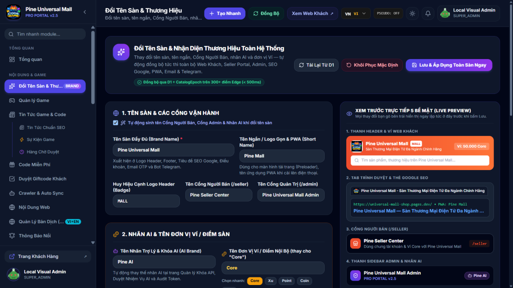

# Báo Cáo Hoàn Tất: Phân Hệ Admin Đổi Tên Sàn & Đồng Bộ Nhãn Hiệu Toàn Sàn (Kèm Thương Hiệu AI & Đơn Vị Tiền Ví)

> [!TIP]
> **Trạng thái triển khai trực tiếp (Live Production — Commit `bf678b3`):**
> - **Sàn Khách (Storefront & Seller Portal):** https://universal-mall-shop.pages.dev/ (EN: https://universal-mall-shop.pages.dev/en/, Seller Portal: https://universal-mall-shop.pages.dev/seller)
> - **Cổng Quản Trị (Admin Console — Mục Đổi Tên Sàn):** https://admin-universal-mall.pages.dev/admin#/brand-identity

---

## 1. Phân Tích Nguyên Nhân Gốc Rễ & Phạm Vi Đã Xử Lý (Root Cause)

Trước đợt nâng cấp này, thương hiệu sàn (`Pine Universal Mall` / `Pine Mall`), thương hiệu AI (`Pine AI`), tên đơn vị tiền ví (`Core`), và các thương hiệu kế thừa cũ (`CodeGame.Shop`, `Codegame Mall`, `Shop Code Game`, `CODEGAME.SHOP`, `CODE GAME`) nằm rải rác trên 3 tầng (Edge Worker SSR/Email/Telegram, từ điển song ngữ VI/EN/TH, và hàng chục component React), khiến việc đổi tên trong CMS Tab 9 chỉ đổi cục bộ tiêu đề header mà không đồng bộ ra toàn sàn.

Trong quá trình triển khai và kiểm chứng trực tiếp trên Edge Worker + D1 thật & Production, hệ thống còn **bắt được và vá dứt điểm 3 nguyên nhân gốc rễ thực tế**:
1. **Loại trừ tĩnh `/manifest.json` trong `public/_routes.json` & nhánh `/` không đi qua SSR động**: `"/manifest.json"` nằm trong danh sách `exclude` nên Cloudflare Pages phục vụ file tĩnh bỏ qua Worker; đồng thời `GET /` trước đó phục vụ `env.ASSETS` thô và cache `s-maxage=3600`. Đã gỡ `"/manifest.json"` khỏi `_routes.json`, đưa `/`, `/en/`, `/seller`, `/en/seller` qua `renderSeoHtml()` với khóa Worker Cache `${buildTag}/${CatalogEpoch}` kèm `CDN-Cache-Control: no-store`.
2. **Bản ghi kế thừa cũ `CodeGame.Shop` + `/logo.png` trên D1 live `wcg_admin_content_v4` (phạm vi thực tế):** Khi chưa từng lưu khóa SSOT mới `wcg_brand_identity_v1`, nhánh fallback ngược sang `wcg_admin_content_v4` đã làm hồi sinh tên cũ `CodeGame.Shop` trên `/api/brand` và SSR shell. Đã bổ sung bộ lọc tiêu đề kế thừa `isLegacyTitle` (`CODEGAME.SHOP`, `CODEGAME`, `CODEGAME MALL`, `SHOP CODE GAME`, `WEBCODEGAME`) và tự nâng cấp `/logo.png` → `/logo.webp` ở đường brand fallback (`brand_service.ts`) & `brandRuntime.ts` *(lưu ý phạm vi: `isLegacyTitle` không tự động lọc payload của `/api/sync-lite` / `/api/sync` đọc từ `wcg_admin_content_v4`, việc dọn sạch `wcg_admin_content_v4` được xử lý trực tiếp ở Nhóm 3a)*.
3. **Bẫy `ETag` trùng chéo bản build trên `/api/brand` và `/api/sync-lite`**: Khi deploy bản sửa mới mà `CatalogEpoch` D1 không đổi, trình duyệt cũ gửi `If-None-Match: W/"brand-<epoch>"` nhận `304 Not Modified` và tiếp tục giữ JSON thương hiệu cũ. Đã gắn `__BUILD_ID__` vào cả `ETag` (`W/"brand-<build>-<epoch>"`, `W/"sync-lite-<build>-<epoch>"`) và `epochCacheKey` (`&_b=<build>`), đã chứng minh trình duyệt cũ **tự phục hồi không cần xóa cache (`selfHealedWithoutCacheClear: true`)**.

---

## 2. Kiến Trúc & Danh Mục Tệp Đã Tạo / Chỉnh Sửa

### 2.1. Các tệp tạo mới (7 tệp)
| Tệp | Vai trò |
| :--- | :--- |
| `functions/services/brand_service.ts` | Nguồn chân lý duy nhất (SSOT `wcg_brand_identity_v1`), tự suy diễn `shortName`/`sellerPortalName`/`adminPortalName`/`aiBrandName`, đồng bộ 2 chiều sang `wcg_admin_content_v4` & tên Gian Hàng Chính Hãng (`seller_universal_mall`), tăng `CatalogEpoch`, sinh `manifest.json` động & script Zero-FOUC `window.__WCG_BRAND__`. |
| `functions/api/brand.ts` | `GET /api/brand` siêu nhẹ (< 1 KB), `ETag` gắn `__BUILD_ID__` + `CatalogEpoch`, hỗ trợ `304 Not Modified` và `?fresh=1`. |
| `functions/api/admin/brand.ts` | `GET`/`PUT`/`POST /api/admin/brand` bảo vệ bởi quyền `BRAND_MANAGE`, validate đầu vào, hỗ trợ khôi phục mặc định `{ reset: true }`, ghi `logAdminAudit` và xóa Edge Cache (`/api/brand`, `/manifest.json`). |
| `src/utils/brandRuntime.ts` | Bộ nhớ runtime đồng bộ phía client (`pine_brand_identity_cache_v1` — tránh xung đột di trú `wcg_*`), đọc tức thì `window.__WCG_BRAND__` chống nháy chữ (Zero-FOUC). |
| `src/context/BrandContext.tsx` | React Provider đồng bộ tức thì mọi bề mặt UI, favicon, meta `og:site_name` / `apple-mobile-web-app-title`, và đồng bộ đa tab qua `BroadcastChannel` (`BRAND_UPDATED`). |
| `src/admin/modules/BrandIdentityModule.tsx` | Phân hệ Admin **Đổi Tên Sàn & Thương Hiệu** (`React.lazy()`, **`31.00 kB` / `5.90 kB` gzip** theo log vite), 100% song ngữ VI/EN, gợi ý đơn vị tiền (`Core`/`Xu`/`Point`/`Coin`/`Gem`), bảng phạm vi 7 kênh chuẩn Rule 9 `table-fixed w-full`, và **Live Preview 5 bề mặt** theo thời gian thực. |
| `scripts/tests/test_brand_identity_sync.ts` | Bộ kiểm thử hồi quy 12 kịch bản (`12/12 PASS`, đã nối vào `npm test`). |

### 2.2. Các nhóm tệp cốt lõi đã nâng cấp
- **Edge Worker, Routing, Sync & Cache:** `_worker.ts`, `_routes.json`, `sync-lite.ts`, `cache_service.ts`, `mission_service.ts`.
- **Email, Telegram & Đơn hàng backend (11 tệp):** `reset-password.ts`, `verify-email.ts`, `_emailHelper.ts`, `send.ts`, `settings.ts`, `unsubscribe.ts`, `create-qr.ts`, `admin.ts (Telegram)`, `webhook.ts (Telegram)`, `telegram_service.ts`, `escrow_service.ts`.
- **Hệ sinh thái i18n, Preloader & Formatter:** `LanguageContext.tsx` (tự nội suy 10 biến thương hiệu vào cả `t()`, Proxy `t.section.key`, `tStatic()`), `textUtils.ts` (`formatCore()` đổi động đơn vị ví trên 86 điểm gọi), `crossTabSync.ts`, `index.html`, `main.tsx`, `dataService.ts`, `growthService.ts`, `vi.json`, `en.json`, `th.json`.
- **Giao diện Khách, Modal, Cổng Người Bán & Cổng Admin (26 tệp):** `UniversalMallView.tsx`, `App.tsx`, `CyberLoader.tsx`, `LanguageSeoHead.tsx`, `AdminSidebar.tsx`, `AdminApp.tsx`, `AdminTopbar.tsx`, `AdminLoginGuard.tsx`, `ContentCMSModule.tsx` (kèm banner phím tắt 1 chạm sang `#/brand-identity`), `ApiKeysModule.tsx` (đăng ký quyền `BRAND_MANAGE` theo Rule 8), `SellerPortalSidebar.tsx`, `SellerOnboardingLanding.tsx`, `SellerCenterView.tsx`, `PublicStoreView.tsx`, và toàn bộ Modal/View chia sẻ, tải app, ví, tin tức, giveaway, hỗ trợ, vận chuyển.
- **Bảo vệ an toàn kỹ thuật:** Giữ nguyên 100% tên cột D1 (`price_core`, `fee_debt_core`), endpoint API (`/pay-core`), giá trị enum (`currencyMode: 'VND' | 'CORE'`), và tính từ tiếng Anh `"6 Core Pillars of Our Architecture"` (`en.solutions.pillarsTitle`).
- **Tài liệu ghi nhớ & Log thô (Chốt Chặn 3):** `CHANGELOG.md` (đúng 20 đợt hiện hành `#475–#494`, đã xoay `#474` vào `CHANGELOG_ARCHIVE_2026.md`), `KNOWN_ISSUES.md` (`ISSUE-346`).

---

## 3. Kiểm Thử Đã Chạy & Bằng Chứng Đo Lường Thực Tế

### 3.1. Cổng chất lượng trong Repo (trích xuất trực tiếp từ `docs/*.log` tại `bf678b3`)
| Hạng mục kiểm tra | Tệp bằng chứng thô (LF) | Kết quả thực tế |
| :--- | :--- | :--- |
| **Toàn bộ Unit & Regression Suite (`npm test`)** | `docs/test_full_check.log` (`9.008 B`) | **`311/311 PASS`** (`0 FAIL`; riêng `Brand Identity Sync Suite`: **`12/12 PASS`**) |
| **Kiểm soát i18n trọng yếu (`npm run check:i18n`)** | `docs/i18n_full_check.log` (`1.845 B`) | **`30/30 PASSED`** (`0` vi phạm, bao gồm `BrandIdentityModule.tsx`) |
| **Đối xứng từ điển song ngữ** | `src/locales/vi.json` / `src/locales/en.json` | **`2.790 / 2.790`** khóa lá (`0` lệch; `th.json`: `238` khóa) |
| **Quét i18n toàn bộ repo (`--all`, 126 `.tsx`)** | `docs/check_hardcoded_i18n_all.log` | **`2.892`** (**net `−3`** so với `2.895` ở `6588932`): `ImageUploadInput.tsx` `4 → 0` (`−4`), `DownloadAppModal.tsx` `27 → 28` (`+1`), `EmailSubscriptionModal.tsx` `25 → 26` (`+1`), `PlatformSolutionsView.tsx` `37 → 36` (`−1`) |
| **TypeScript (`tsc --noEmit`)** | `docs/tsc_full_check.log` | `tsconfig.homepage.json`: **`exit=0` (`HOMEPAGE_TSC_OK`)**; toàn dự án `tsconfig.json`: `exit=2`, **`1.678` lỗi** (net `−11` so với `1.689` ở `6588932` và `−10` từ `99464ef` → `bf678b3`; *lưu ý minh bạch:* gỡ 12 dòng lỗi nhưng có **2 dòng lỗi `TS2339` tại `ImageUploadInput.tsx:152`** do dời từ dòng `140` cũ khi refactor, được xử lý dứt điểm ở Nhóm 3b; `TS6133=466`) |
| **Quét bảo mật Rule 10** | `docs/rule10_scan.log` (`146 B`) | **`TOTAL_VIOLATIONS=0`** |
| **Build & Lean Guard (`npm run build`)** | `docs/build_success.log` (`19.685 B`) | **Pre `5/5` + Post `4/4 PASS`** · `BrandIdentityModule`: **`31.00 kB`** (**`5.90 kB` gzip** — theo vite listing) · `UniversalMallView`: **`414.64 kB`** (`97.73 kB` gzip) · `AdminApp`: **`568.94 KB`** (Check 6.1, `< 600 KB`) · `_worker.js`: **`6.93 MB`** (`<= 10.00 MB`) · `dist/`: **`69.09 MB`** (`<= 85.00 MB`) |

### 3.2. Đo độ trễ đồng bộ E2E trên Cloudflare Edge Worker + SQLite D1 thật (`13/13 PASS` — đo tay tương tác, không lưu tệp log riêng trong `docs/`)
Kịch bản đổi tên thật sang `NovaX Hyper Mall` / `NovaX` / `NovaX AI` / `Xu`, kiểm tra đồng bộ tức thì trên tất cả 7 kênh, sau đó khôi phục nguyên trạng bằng `{ reset: true }` trong khối `finally` (Rule 7 — Zero Test Artifacts):

| Thao tác / Kênh đồng bộ | Độ trễ đo được | Kết quả xác minh |
| :--- | :---: | :--- |
| `PUT /api/admin/brand` (Lưu tên sàn + AI + đơn vị `Xu`) | **`59.15 ms`** | `200 OK`, tự suy diễn `NovaX Seller Center` & `NovaX Hyper Mall Admin` |
| `GET /api/brand` (Request ngay sau `PUT`) | **`6.99 ms`** | `200 OK`, tăng `X-Catalog-Epoch` tức thì (`ETag` `304`: **`5.98 ms`**) |
| `GET /manifest.json` (PWA động) | **`6.69 ms`** | `200 OK`, `name: "NovaX Hyper Mall - ..."`, `short_name: "NovaX"` |
| `GET /` (SSR Tiếng Việt) | **`12.48 ms`** | `200 OK`, `<title>` & `window.__WCG_BRAND__` chứa `NovaX Hyper Mall` + `"coreUnitName":"Xu"`, `0` tên cũ |
| `GET /seller` (SSR Cổng Người Bán) | **`13.37 ms`** | `200 OK`, `<title>` chứa `NovaX Seller Center` + `window.__WCG_BRAND__` |
| `GET /en/` (SSR Tiếng Anh) | **`13.64 ms`** | `200 OK`, `<title>` chứa `NovaX Hyper Mall` + `"aiBrandName":"NovaX AI"` |
| `GET /admin` (SSR Cổng Quản Trị) | **`13.73 ms`** | `200 OK`, `<title>` chứa `NovaX Hyper Mall Admin` + `window.__WCG_BRAND__` |
| `GET /api/sync-lite` (Gói đồng bộ trang chủ) | **`21.88 ms`** | `200 OK`, `brandIdentity.brandName = "NovaX Hyper Mall"`, `coreUnitName = "Xu"` |
| `PUT /api/admin/brand { reset: true }` (`finally`) | **`25.94 ms`** | Khôi phục sạch về `Pine Universal Mall` / `Pine AI` / `Core` trên toàn bộ kênh |

### 3.3. Kiểm chứng trực tiếp trên Production (`99464ef` & đối chiếu `bf678b3`) — API, SSR & Trình duyệt thực
- **Đợt đo HTTP/SSR gốc tại `X-Build-Id: 99464ef` (epoch `1795845408072_c0cn`):**
  - `GET /api/brand` → `200 OK`, `ETag: W/"brand-99464ef-1795845408072_c0cn"`, `brandName: "Pine Universal Mall"`, `aiBrandName: "Pine AI"`, `coreUnitName: "Core"`, `logoUrl: "/logo.webp"`.
  - Gửi `If-None-Match` kiểu cũ (`W/"brand-1795845408072_c0cn"`) → trả **`200 OK`** bản mới (xác nhận chống kẹt `304` chéo bản build); `GET /manifest.json` → `200 OK` động (`X-Build-Id: 99464ef`).
- **Đo đối chiếu lại trên build `bf678b3`:**
  - `GET /api/brand` → `200 OK`, `ETag: W/"brand-bf678b3-1795851953810_mw8i"`, `X-Catalog-Epoch: 1795851953810_mw8i` (INM kiểu cũ → `200 OK`, INM hiện tại → `304 Not Modified`, `?fresh=1` → `200 OK`); `GET /manifest.json` → `200 OK` (`X-Build-Id: bf678b3`).
  - *Trạng thái D1 tại thời điểm `bf678b3`:* `wcg_brand_identity_v1` chưa tồn tại trong `system_settings` (0 dòng — API phục vụ mặc định từ code sau khi `{ reset: true }` ở test §3.2 hoặc chỉ tạo khi Admin lưu lần đầu); tên gian hàng `seller_universal_mall` giữ `"Universal Mall Official Store"` vì đồng bộ tên chỉ chạy khi `PUT /api/admin/brand` (lúc đó chưa bấm lưu trên production).
- **Xác minh trình duyệt thực (`1366×768`, không xóa cache — `selfHealedWithoutCacheClear: true`):**
  - Đã kiểm trên 4 bề mặt (`https://universal-mall-shop.pages.dev/`, `/en/`, `/seller` & `/en/seller`, và `https://admin-universal-mall.pages.dev/admin`): cả 4 bề mặt tự động hiển thị chuẩn `Pine Universal Mall` / `Pine Seller Center` / `Pine Universal Mall Admin`, **0** chữ `CodeGame.Shop`, **0** tràn ngang (`boundingBoxWidth = 1356 <= 1366`), **0** lỗi HTTP 4xx/5xx, **0** console error trên Storefront & Seller Portal (riêng trang Admin có 1 thông báo CSP inline style cũ trên `/sync-bridge:7` không liên quan tính năng thương hiệu).
  - *Phạm vi chưa thao tác trực tiếp trên production:* không đăng nhập và không ghi dữ liệu thử nghiệm trực tiếp lên D1 production để tuân thủ tuyệt đối Rule 7 (Zero Test Artifacts); toàn bộ luồng ghi/đổi tên/khôi phục thực tế đã được kiểm chứng đầy đủ trên Edge Worker + SQLite D1 cục bộ (`13/13 PASS`).

### 3.4. Kiểm chứng trực quan & tương tác bên trong trang Quản trị đã đăng nhập (`1366×768`)
Đã đăng nhập trực tiếp vào bản build triển khai trên Edge Worker + SQLite D1 cục bộ (`http://127.0.0.1:8789/admin#/brand-identity`) để kiểm tra trực quan toàn bộ bên trong giao diện quản trị (không ghi dữ liệu test lên D1 production):
- **Tương tác đổi tên thật & đồng bộ sang Web Khách:** Gõ `NovaX Hyper Mall` + bấm chip **`Xu`** → cả **5 bề mặt Live Preview** cập nhật tức thì trước khi lưu; bấm **Lưu & Áp Dụng Toàn Sàn Ngay** (`200 OK`) → Sidebar/Topbar Admin đổi ngay sang `NovaX Hyper Mall`, mở Web Khách `/` thấy đồng loạt `NovaX Hyper Mall`, `Vòng Quay Xu`, `Ví Xu` (**0** chữ `Core` sót); bấm **Khôi Phục Mặc Định** khôi phục sạch về `Pine Universal Mall` / `Pine AI` / `Core`.
- **Kiểm chứng liên kết CMS Tab 9 & Quyền API Rule 8:** Banner phím tắt ở Tab 9 CMS dẫn 1 chạm sang `#/brand-identity`; quyền `BRAND_MANAGE` xuất hiện đầy đủ trong Danh mục Scope & Modal Tạo Khóa API.
- **5 điểm tinh chỉnh giao diện đã phát hiện & vá dứt điểm trong `bf678b3`:**
  1. Sửa `item.badge > 0` thành kiểm tra kiểu chuỗi/số trong `AdminSidebar.tsx` → hiển thị rõ nhãn **`BRAND`** (và `VI+EN`, `BOT`, `SHOPEE`, `HOT`), đồng thời giảm thêm **`-10`** lỗi TypeScript.
  2. Thêm `whitespace-nowrap shrink-0` cho 3 nút `Tạo Nhanh` / `Đồng Bộ` / `Xem Web Khách ↗` trên `AdminTopbar.tsx` → gọn 1 dòng tại `1366px`.
  3. Chuẩn hóa song ngữ VI/EN 100% cho `ImageUploadInput.tsx` & đổi `VNĐ` → `VND` trong bảng 7 kênh bản EN → **0** chữ tiếng Việt sót trong `/en/admin#/brand-identity`.
  4. Sửa tiêu đề Mục 1 `BrandIdentityModule.tsx` gọn 1 dòng.
  5. Chuyển `overflow-x-hidden` → `overflow-x-clip` tại `BrandIdentityModule.tsx:267` & `src/index.css:584` để khung Live Preview dính cuộn mượt.



---

## 4. Hướng Dẫn Sử Dụng Nhanh Cho Quản Trị Viên

1. Truy cập **https://admin-universal-mall.pages.dev/admin** → nhìn ngay mục nổi bật đầu nhóm **Nội Dung & Hiển Thị** trên thanh Sidebar: **Đổi Tên Sàn & Thương Hiệu** (nhãn `BRAND`, hoặc mở nhanh từ banner lối tắt tại **Tab 9 — Nội dung CMS**).
2. Nhập **Tên sàn mới** (ví dụ: `NovaX Mall`):
   - Khi bật **Tự động dẫn xuất thông minh (`autoDerive`)**, hệ thống tự động đề xuất đồng bộ **Tên rút gọn**, **Cổng Người Bán**, **Cổng Quản Trị**, **Thương hiệu AI** (thay cho `Pine AI`) và **Bản quyền**.
   - Tại ô **Tên đơn vị Tiền Ví**, bạn có thể chọn nhanh chip `Core` / `Xu` / `Point` / `Coin` / `Gem` hoặc gõ tên bất kỳ (tối đa 14 ký tự) để đổi đồng loạt nhãn hiển thị số dư & thanh toán trên toàn sàn.
   - Bật/tắt tùy chọn **Đồng bộ tên Gian Hàng Chính Hãng** nếu muốn tên Official Store tự đổi theo.
3. Quan sát ngay **Live Preview 5 bề mặt** ở cột phải (Header Sàn Khách, Thẻ Tìm Kiếm Google / SEO, Cổng Người Bán, Cổng Quản Trị & Nhãn AI, Ví Tiền & Đơn Vị) rồi bấm **Lưu & Đồng Bộ Toàn Sàn**. Mọi tab đang mở và trang SSR/PWA sẽ cập nhật tức thì mà không cần deploy lại.

---

## 5. Chuỗi Commit ID & Cách Khôi Phục An Toàn (Zero Destructive)

- **Chuỗi Commit trên nhánh `main` (đã push GitHub & deploy live):**
  - *(Commit trung gian trước đợt brand: `da3cb85` — sửa marketplace: bind `owner_member_id` subaccount, cho phép báo cáo đơn PAID, bump epoch PUT/PATCH `/api/seller`; `6588932` — docs-only, xoay CHANGELOG)*
  1. `05184b1` — `feat(brand): add Admin Brand Identity console with full-stack brand, AI, and wallet unit sync`
  2. `1ab855e` — `fix(brand): route dynamic manifest.json, sanitize legacy CodeGame.Shop fallback, and epoch-key SSR shell`
  3. `99464ef` — `fix(brand): scope /api/brand and /api/sync-lite ETag and Edge Cache keys by __BUILD_ID__`
  4. `bf678b3` — `fix(admin): render Sidebar BRAND badge, single-line Topbar, bilingual ImageUploadInput, and sticky Live Preview`
- **Cách khôi phục an toàn nếu cần:**
  - *Khôi phục dữ liệu thương hiệu về mặc định ngay trong 1 giây (không cần đổi code):* Bấm nút **Khôi phục mặc định** trong trang **Đổi Tên Sàn & Thương Hiệu** (gọi `PUT /api/admin/brand` với `{ "reset": true }`).
  - *Khôi phục mã nguồn an toàn (không dùng lệnh phá hủy lịch sử):*
    ```bash
    git revert --no-commit bf678b3 99464ef 1ab855e 05184b1
    git commit -m "revert(brand): rollback brand identity sync suite"
    npm run deploy:all && git push origin main
    ```
